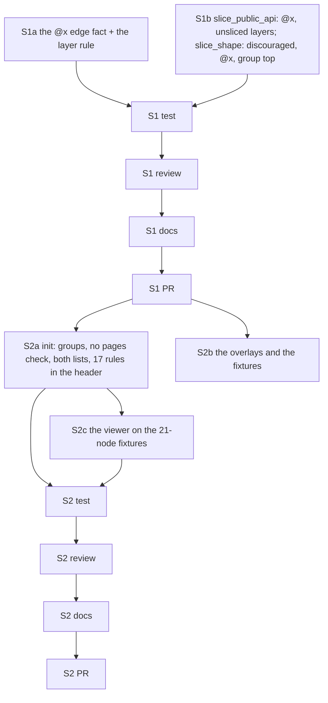

# PLAN: BDL-082 — FSD by the specification 2.1

> **Status:** Approved
> **Approval:** delegated by the owner on 2026-10-11.
> **Created:** 2026-10-11

---

## Epic Description

Two slices, one PR each. S1 changes the rules and the reindex's edge fact (D1, D4, D5); S2
changes `init`'s layout reader and written rules, the overlays and the fixtures (D2, D3, D6)
and runs after S1's PR so its fixtures are judged by the new rules.

## Dependency DAG

Parent: `beadloom-us5r`.

## Beads

| ID | Tracker | Name | Priority | Depends On |
|---|---|---|---|---|
| S1a | `beadloom-r15q` | dev: the reindex records `via: "@x"` on a same-layer edge whose every import lands on `@x/<importer>`; `same_layer_crossings` accepts it on entities, reports it elsewhere with the spec's wording (D1) | P0 | - |
| S1b | `beadloom-8sml` | dev: `slice_public_api` reads `@x/<B>` as A's second API open to B, covers `shared`/`app` segments with per-component indexes as entries; `slice_shape` gains `discouraged:`, knows `@x`, flags code at a group's top (D1, D4, D5) | P0 | - |
| S1T | `beadloom-wvzg` | test: the specification's examples as scratch probes — 0 false findings, every real one; Steiger's verdict beside ours; the full tree once | P0 | S1a, S1b |
| S1R | `beadloom-r4ck` | review: S1, bead id only | P0 | S1T |
| S1W | `beadloom-chdr` | tech-writer: the rule-engine SPEC, public-api.md (`via`, `discouraged:`), CHANGELOG | P0 | S1R |
| S1P | `beadloom-vv3e` | coordinator: S1 PR, merge on green | P0 | S1W |
| S2a | `beadloom-6e2o` | dev: `fsd_layout.py` reads groups (D2); `rules_gen.py` writes no `pages` check, both segment lists, the rule over every layer, the 17-rule header (D3, D4, D5, D6) | P0 | S1P |
| S2b | `beadloom-keki` | dev: the five fsd overlays restated (D6); the two FSD fixtures gain a group and an `@x` pair; the adopter harness expects the new findings | P0 | S1P |
| S2c | `beadloom-us5r.1` | dev: the viewer's layout holds on the FSD fixtures with a group and `@x` pairs — 9 browser cases red on the new shapes (found by S2b, 2026-10-11) | P0 | S2a (the S2b edge removed 2026-10-11, owner: the fixtures landed in `c7963f7c`; no shared file) |
| S2T | `beadloom-q2el` | test: `init` on the probes and the fixtures; the eight adopter portals; the full tree once | P0 | S2a, S2b |
| S2R | `beadloom-r8y2` | review: S2, bead id only | P0 | S2T |
| S2W | `beadloom-rm5a` | tech-writer: the agent-prime SPEC, the onboarding README, the overlay docs, CHANGELOG | P0 | S2R |
| S2P | `beadloom-iuky` | coordinator: S2 PR, merge on green | P0 | S2W |

## Bead Details

Each dev bead's "what to do" is its RFC decision; "done when" is the PRD goal's *Done when*
plus: cases red first on the specification's scratch examples; two-level verification; the full
tree once per slice by its test bead; commits by path under the slot. The tracker ids fill the
table when the beads are created.
