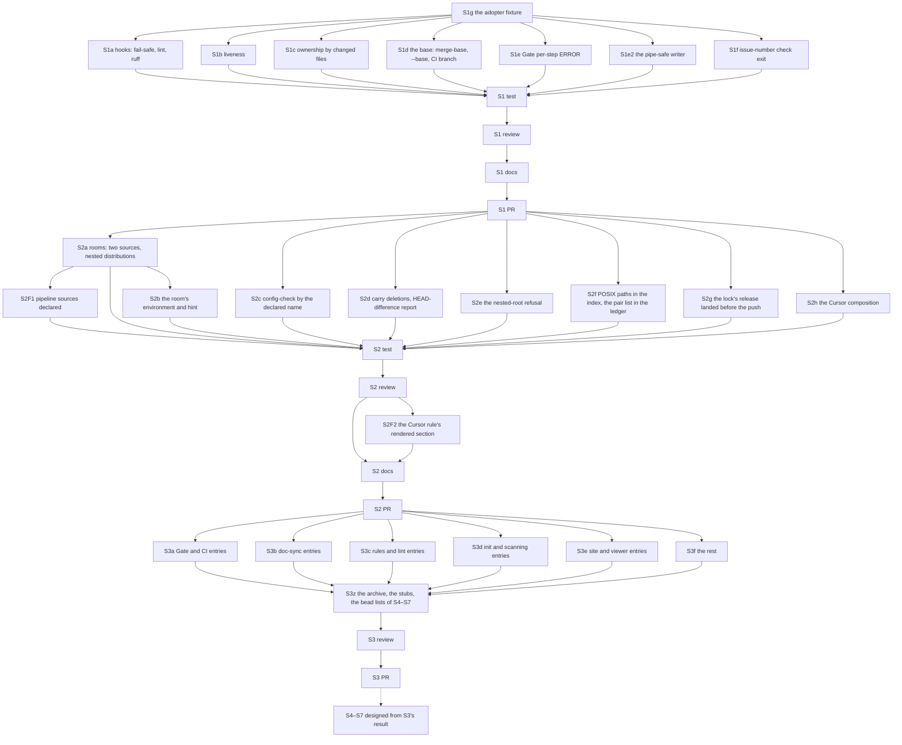

# PLAN: BDL-083 — Debt to zero

> **Status:** Approved
> **Created:** 2026-10-18

---

## Epic Description

Seven slices, one PR each, in the order of the PRD's ruling 1. This PLAN designs S1 and S2 to
the bead and S3 to the measurement bead; S4–S7 are designed when S3 closes, each as a section
appended here and approved on its own (ruling 6). Beads are created per slice, after the section
is approved; existing beads that already hold an entry are reused, not duplicated.

## Dependency DAG

Parent: `beadloom-ba9w`.

## Beads

| ID | Tracker | Name | Priority | Depends On |
|---|---|---|---|---|
| S1g | `beadloom-483w` | dev: the adopter's layout as an anonymised fixture under `tests/fixtures/` — `backend/pyproject.toml` + `uv.lock`, `frontend/` (FSD, two spec files beside code), `.gitlab-ci.yml`, a domain and a feature sharing a subpackage name, `.beadloom/` initialised; a test that the fixture indexes | P0 | - |
| S1a | `beadloom-7i09` | dev: the composed hooks — pre-push exits non-zero with a sentence without `beadloom` on PATH and prints the verdict line or "the Gate did not run"; pre-commit runs `lint --strict` over the nodes of staged paths; the ruff leg shows stderr, tells exit 127 from 1, reads the owning project's configuration (D1; #326, #327) | P0 | S1g |
| S1b | `beadloom-q8x6` | dev: liveness for `forbid_import` and `test_import_boundary` — unmatchable glob vs live with nothing to ban, by the matcher on the glob's literal prefix; the second at `info` (D2; #328) | P0 | S1g |
| S1c | `beadloom-b23f` | dev: `derive_gate_ownership` attributes by the files a bead's commits changed; `unattributed` otherwise; the surfaces print the rule (D3; #329) | P0 | S1g |
| S1d | `beadloom-fgu8` | dev: `scope_base` — merge-base with the parent branch, `--base`, trunk as fallback; the base and the parent-attributed count in the headers of `scope-check`, the Gate step and `review-brief`; the CI branch from `GITHUB_HEAD_REF` or `CI_MERGE_REQUEST_SOURCE_BRANCH_NAME` (D4; #330, #344; `beadloom-tsqz` #300 closes inside) | P0 | S1g |
| S1e | `beadloom-ba9w.13` | dev: the Gate's per-step exception boundary and `ERROR` status; "N step(s) crashed" in the summary (D1; #318) | P0 | S1g |
| S1e2 | `beadloom-jwfc` | dev: `ci` writes through a writer that survives `EAGAIN` on a non-blocking pipe; the hook tells a Gate that crashed from one that failed; a test that hands it a non-blocking pipe (D1; #226) | P0 | S1g |
| S1f | `beadloom-6xdt` | dev: `issue-number check` and the Gate step share one function and one exit code (D5; #331) | P0 | S1g |
| S1T | `beadloom-rupp` | test: each S1 entry's own `Command` re-run on the fixture or this repository, red first then green; the three MAJOR moves as tests; the full tree once | P0 | S1a–S1f |
| S1R | `beadloom-pohj` | review: S1, bead id only; re-run after the fix beads | P0 | S1T, S1F1–S1F5 |
| S1F1 | `beadloom-4m0w` | dev: S1R Major 1 + Minor 5 — the post-step reports of the Gate inside the exception boundary; the lint summary counts statements at info | P0 | S1R (first pass) |
| S1F2 | `beadloom-ilrn` | dev: S1R Major 2 — the debt report counts `info` as neither an error nor a warning | P0 | S1R (first pass) |
| S1F3 | `beadloom-7kas` | dev: S1R Minors 3, 4, 6 and the nitpick — the printed ownership rule states its binding; the "can match none" sentence hedged; the hook names public; the fixture rule named for its glob | P0 | S1R (first pass) |
| S1F4 | `beadloom-ba9w.17` | dev: S1R — the MCP `complete_bead` gaps of the #318 class: `not_run` when the coverage report raised, the verdict room's census bounded | P0 | S1F3 |
| S1F5 | `beadloom-ba9w.18` | dev: S1R pass 2 — the `Bead:` trailer in the message's final paragraph (format, fragments, checklist); the ownership report names a line git reads no trailer from; the MCP verdict reads the gate's room; the source-root lead-in; two nitpicks | P0 | S1R (second pass) |
| S1F6 | `beadloom-g64s` | dev: the JSON and MCP `claims` entry names the commits whose `Bead:` line git reads no trailer from; the pass-3 nitpicks | P0 | S1R (third pass) |
| S1R6 | `beadloom-sywb` | review: fix 6, bead id only | P0 | S1F6 |
| S1F7 | `beadloom-kdx7` | dev: `placement` a token with the sentence beside it; the `complete_bead` tool description points at the verdict | P0 | S1R6 |
| S1R7 | `beadloom-mnln` | review: fix 7, bead id only | P0 | S1F7 |
| S1F8 | `beadloom-tlgk` | dev: the pipe-safe writer waits for room with `poll`, not `select` (Linux FD_SETSIZE); a test over a descriptor >= 1024 | P0 | S1P (CI) |
| S1R8 | `beadloom-kwc3` | review: fix 8, bead id only | P0 | S1F8 |
| S1W | `beadloom-hfxv` | tech-writer: the ci-gate and rule-engine SPECs, `docs/guides/ci-setup.md` (the hook's new behaviour), `docs/guides/public-api.md` (the MAJOR moves), CHANGELOG | P0 | S1R, S1R6, S1R7 |
| S1P | `beadloom-c5m5` | coordinator: S1 PR, merge on green | P0 | S1W, S1R8 |
| S2a | `beadloom-3618` | dev: `rooms` reads `.github/workflows/*.yml` and `.gitlab-ci.yml` as sources of legs, each room carrying its source; distributions by `**/pyproject.toml` under `scan_paths`; a CI the census cannot read is a named skip in `ci`; `gate-coverage` reads the same sources (D6; #332) | P0 | S1P |
| S2b | `beadloom-cptm` | dev: `clean-room` builds the environment of the distribution that owns the carried files from its `uv.lock` (`uv sync --frozen`), derives the "Measure in the room" hint from it, names the no-`.git` limit (D6; #333; `beadloom-ba9w.1` #311 closes inside) | P0 | S2a |
| S2c | `beadloom-ixbd` | dev: `config-check` composes by the declared project name and names both files; one verdict in a room, a worktree and the checkout (D7; #334) | P0 | S1P |
| S2d | `beadloom-flrc` | dev: `--carry` of a path the tree no longer holds is a deletion in the room; the room reports files where the tree differs from HEAD by more than this bead's commits (D6; #335) | P0 | S1P |
| S2e | `beadloom-7pd6` | dev: a project root below the git root is refused by `init` and `doctor` in words, non-zero (D6; #325) | P0 | S1P |
| S2f | `beadloom-27br` | dev: indexed paths written as POSIX at every write site and `source:` normalised at every match site; `doctor` names a backslash index as one to rebuild; `sync-surface.json` carries the pair list; a backslash test over the three match sites and a simulated-separator index of the fixture (D11; #353) | P0 | S1P |
| S2g | `beadloom-89gm` | dev: the composed landing fragments and the coordinator checklist state acquire → commit → release → export landed → push; the pre-push hook refuses a tree whose export holds the slot for the pushed bead; `waves` names the remedy for a slot held by a closed bead; two tests (D12; #354) | P0 | S1P |
| S2F1 | `beadloom-ba9w.22` | dev: the pipeline files the census reads are declared in `config.yml` under `rooms.pipelines`; unset reads every file present; a present file the key excludes is set aside naming the key; S2a's GitHub-first ordering withdrawn; this repository declares `[github]`; three tests (D6 amended) | P0 | S2a |
| S2h | `beadloom-ybxm` | dev: `setup-agentic-flow --tool cursor` composes the core, the project layer, the STACK overlay and the four commands into `.cursor/rules/` as `alwaysApply` rules; `config-check` names a tool whose composition lacks a layer and stops reporting `.claude/agents/<role>.md` missing on a cursor-only project; `setup-mcp` and `init --bootstrap` write a portable MCP command; the composed `task-init` text names an absolute plan path (D13; #356 a, e, g) | P0 | S1P |
| S2T | `beadloom-w2v6` | test: each S2 entry's own `Command` on the fixture — a named room, a built environment, one `config-check` verdict in a room and the checkout, one pair set under both separators, the lock's release landed before the push; the full tree once | P0 | S2a–S2h, S2F1 |
| S2R | `beadloom-x94h` | review: S2, bead id only; re-run after the fix beads | P0 | S2T, S2F2 |
| S2F2 | `beadloom-ba9w.24` | dev: S2R pass 1 Major 1 — the Cursor core rule's rendered project-info section blanked on both sides of the drift comparison as the CLAUDE.md check does; `setup-rules --refresh` re-renders it in the Cursor rule (D13) | P0 | S2R (first pass) |
| S2W | `beadloom-sc9d` | tech-writer: the verdict-room and wave-plan SPECs, `docs/guides/parallel-waves.md` (the room's environment and hint), the monorepo paragraph of `docs/getting-started.md`, CHANGELOG | P0 | S2R, S2F2 |
| S2P | `beadloom-6svu` | coordinator: S2 PR, merge on green | P0 | S2W |
| S3a | `beadloom-k6f1` | measure: the open entries of the Gate, CI, hooks and rooms area, each re-run by its `Command` on the S2 version; closed with evidence, filed as a bead under `beadloom-ba9w`, or put to the owner for a `Won't fix` ruling (D9) | P0 | S2P |
| S3b | `beadloom-wvcc` | measure: the doc-sync and docs-audit entries, the same protocol | P0 | S2P |
| S3c | `beadloom-al1i` | measure: the rules, lint and liveness entries | P0 | S2P |
| S3d | `beadloom-d9te` | measure: the `init`, scanning and `doctor` entries | P0 | S2P |
| S3e | `beadloom-8pzg` | measure: the site, viewer and portal entries | P0 | S2P |
| S3f | `beadloom-3jlv` | measure: every remaining entry (TUI, MCP, federation, release, process) | P0 | S2P |
| S3z | `beadloom-mhi2` | dev: the archive and the stubs written, #196 and #288 accounted for, `measured_on` stamped on every surviving entry, the bead lists of S4–S7 drafted as PLAN sections for the owner | P0 | S3a–S3f |
| S3R | `beadloom-rrz5` | review: S3 — every close carries evidence, every live entry a bead, every ruling a reason; bead id only | P0 | S3z |
| S3P | `beadloom-3me7` | coordinator: S3 PR, merge on green; the S4–S7 sections put to the owner | P0 | S3R |

S4–S7 are not in this table yet: their beads are drawn from S3z's result and appended here as
sections, each approved before its beads are created. S3z drafted the four sections at the end
of this document on 2026-10-20, with the rulings the re-measurement puts to the owner; the beads
it created for live entries are children of `beadloom-ba9w` so that every live entry names one,
and a section the owner rejects closes its beads as not planned.

### S3 — the assignment of the open index (132 entries on 2026-10-20)

Each measure bead re-runs its entries by their own `Command` on the S2 version (`main` at `41245dc7`), in a git worktree or a fixture copy under the scratchpad and never on the main checkout's index, and writes one evidence file `s3/<key>.md` in this folder: one section per entry — the command, where it ran, what it printed, the outcome (closed / live / Won't-fix candidate), the bead reused or proposed. S3z writes the archive, the index and `measured_on` from the six files. An entry measured under the wrong area is named in the file under "not this area" and S3z routes it.

| Bead | Area | Entries |
|---|---|---|
| S3a | the Gate, CI, hooks, rooms, scope-check, ownership, the issue-log leg | #357, #354, #353, #335, #334, #333, #332, #331, #330, #329, #327, #326, #325, #321, #318, #311, #310, #301, #300, #287, #280, #276, #273, #246, #226, #199, #198, #178 |
| S3b | doc-sync, docs-audit, doc shape, the README pair | #349, #348, #347, #346, #345, #342, #322, #315, #279, #223, #209, #208, #206, #205, #203, #202, #200, #190, #179, #167, #166, #163, #161, #140, #138, #134 |
| S3c | rules, lint, liveness, the debt report, FSD | #352, #341, #340, #328, #323, #312, #295, #294, #292, #291, #222, #221, #201, #197, #158, #148, #147 |
| S3d | `init`, scanning, the index, `doctor`, `ctx`, `impact`, flow setup | #356, #351, #350, #339, #338, #337, #324, #320, #319, #317, #314, #293, #290, #278, #277, #263, #225, #220, #218, #217, #215, #184, #176, #162, #145, #95, #73 |
| S3e | the site, graph output, snapshot, federation, AsyncAPI | #343, #160, #149 |
| S3f | waves, review-brief, active-sync, the branch binding, the test suite, external, research | #355, #344, #336, #316, #309, #308, #302, #299, #297, #286, #275, #272, #271, #269, #268, #260, #257, #242, #232, #230, #229, #224, #219, #210, #187, #185, #168, #156, #155, #154, #96 |

## Bead Details

Each dev bead's "what to do" is its RFC decision; "done when" is the PRD goal's *Done when*
plus: the entry's own `Command` red first on the fixture or this repository and green after;
the MAJOR moves as tests; two-level verification; the full tree once per slice by its test bead;
commits by path under the landing lock; the entry's text in the issue log untouched until S3
closes it with the evidence the test bead recorded. `beadloom waves` derives the waves from the
beads' scopes: S1d, S1e, S1e2 and S1f share `application/gate.py` and `services/commands/federation.py`,
so the derivation, not this table, says which of them run together. Measurement beads of S3
write no code; their output is the archive text, the bead list and the rulings list, each line
with the date, the version and the command that was run.

## S3 — rulings put to the owner

Measured by the six S3 beads on 2026-10-20 on 9.0.0 (the code of `main` at `41245dc7`); the
evidence of each row is the entry's section in `s3/S3<x>.md`. A Won't-fix candidate stays open
in the issue log, with `measured_on`, until the owner rules; a ruling the owner gives is
archived with its reason.

| Entry | The question | The measurer's recommendation | Bead |
|---|---|---|---|
| #198 | Over a tree that is not a git work tree, `ci` exits 0 with `sync-check WARN: 0 pair(s) fresh, 845 NOT VERIFIED`. Keep the WARN at exit 0, or block? | S3a: Won't-fix candidate. For keeping WARN: a tree without git cannot be verified, and blocking punishes a checkout style. Against: the clean room has no `.git` by construction and is where verdicts are taken. #273 holds the reporting half (`beadloom-3bzw`). | none |
| #178 | An `infra` verdict of the `ai-techwriter` job exits 0 with a warning annotation, so a required check reports success over documents it did not check. Exit 1 on `infra`, drop the job from the required set, or keep it? | S3a: Won't-fix candidate, read in the code and not run. The exit 0 is a recorded decision, and no exit code gives an Actions job a neutral conclusion. | none |
| #187 | `bd list --json` still returns a filtered view as a bare list (bd 1.0.4); every Beadloom call site of `bd list` is secured (`bd-calls`: 0 unsecured). | S3f: Won't fix as External, like #97: archive this project's half as closed and move the upstream half to Excluded Issues. | none |
| #168 | No seed is pinned in CI or `addopts`, and every run prints its seed. Pin a seed? | S3f: Won't fix. A red run is replayable from the seed it prints, the shared live index that made seeds not reproduce is gone since BDL-074, and a pinned seed removes the order-dependence search the plugin was added for (BDL-059 S1). | none |
| #73 | `doctor` warns on version and package claims in a hand-written `CLAUDE.md`. Limit the check to the generated regions? | S3d: Won't fix. The warning now compares the claims with this project's declared version and packages, is true and at `warn`; limiting it to the generated regions would stop it catching a `CLAUDE.md` carried over from another project. If the owner prefers the entry's Expected, the bead is "doctor reads version and package claims only inside the auto regions". | none |
| #160 | Nothing under `src/` calls the AsyncAPI adapter, five documents describe it as ingestion, and a contract pointing at an AsyncAPI document federates CONFIRMED over a body nobody read (#365). Wire it, or downgrade the claims? | S3e: either re-parent `beadloom-g79p` under `beadloom-ba9w` and wire the adapter, or downgrade the five claims to "unwired building block" now; the second costs a document edit, and while it waits the claim stays false. | `beadloom-g79p` (deferred, P2, no parent) |
| #219 | The brief reports 52 of 52 commit bodies as reachable and withholds none: option (b) shipped, and no decision between (a), (b) and (c) is recorded. | S3f: (b) as shipped is a candidate for closing the bead. The bead is one the PRD keeps outside this epic (the flow-lesson organ). | `beadloom-tm76` |
| #223 | `docs quality` reports `missing-section: 146 finding(s) over 328 read` (102 of 256 on 2026-09-02). A dated cut-off for the archive, a computed standing count, or Won't fix with a dated stand-down? | S3b: the owner chooses between the bead's two outcomes; a Won't fix with a dated stand-down for the archive is equally valid. | `beadloom-l27n` |
| #208 | Two docstrings in `graph/rules` are false; prose that names no dead symbol is a class nothing mechanical can find. Rule the class? | S3b: fix the two docstrings by the bead, and rule the class a Won't fix: no check finds prose that names nothing. | `beadloom-aiha` |
| #206 | Every `docs/**/features/*/SPEC.md` is excluded from `docs audit` by a built-in pattern. Read the feature SPECs, or keep the exclusion with its reason? | S3b: the choice is the owner's; #179's type count is also unchecked while the SPECs are excluded. | `beadloom-ik18` |
| #293 | The entry's own rule is one month without the signature (about 2026-10-29); 21 days measured clean (the suite under `--cov`, the 5 failed CI runs since 2026-09-29; the 10 cancelled runs not read). S3z archived it. Waive the remaining days, or hold the month? | S3d: closed on the evidence. If the owner holds the month, the entry returns to the open index without a bead until 2026-10-29. | `beadloom-qq6m` (closed) |
| #154, #155 | The two research notes are partly shipped: #154 C and the rule half of I; #155 A (`waves`) and C (`review-brief`). Archive them as research, carrying the open items as beads? | S3f: archive both as research with the shipped items named; carry #154 F (`beadloom-vom5`) and #154 H with #155 B (`beadloom-wvf3`). | `beadloom-vom5`, `beadloom-wvf3` |
| #353 | The Windows half cannot be measured without a Windows room (the leg was withdrawn); the platform-free half holds (`sync-surface.json` lists its 845 pairs, the simulated-separator tests pass, 104 tests). Close on that evidence, or keep the entry open until a Windows room exists? | S3a: not reproducible here; the separator half stays unmeasured until a Windows room exists. | none (`beadloom-27br`, S2f, closed) |
| #297 | The live entry's bead `beadloom-6rfz` is a flow-lesson organ bead the PRD keeps outside this epic, while D9 asks for a bead under `beadloom-ba9w`. Keep it outside, or adopt it into S7? | S3z: the PRD's non-goal decides unless the owner adopts it; the same question holds for `beadloom-tm76` (#219). | `beadloom-6rfz` |
| #217 | After `init --mode import`, `init --bootstrap` names both orphaned domains and parents neither; the bead's decision between its options (a), (b) and (c) is not taken. | S3d: live as the entry describes, decision pending. | `beadloom-gv0z` |
| #323 | No naming of a grouped slice's `@x` API passes both Beadloom and Steiger 0.7.0. A form both accept, or a row of the SPEC's difference table and a sentence of the FSD overlays? | S3c: the entry leaves the choice to the owner. | `beadloom-ben1` |
| D9 placement | 26 of the 36 reused beads have no parent; D9 asks for a live entry's bead under `beadloom-ba9w`. | S3z: re-parent each with its slice's approval, except the beads the PRD keeps outside (`beadloom-tm76`, `beadloom-6rfz`), the CI trust boundary `beadloom-dlb6` (its own ROADMAP item) and `beadloom-g79p` until #160 is ruled. | the reused rows below |

## S4 — the false-stale family (Draft — awaiting the owner's approval)

PRD goal 4: a file owned by another node is not an untracked file of the directory's node,
incremental `reindex` opens pairs for new files, `symbols_changed` names what clears it, the
test mirror requires the module file, a test file's import is a test edge, an annotation
decides ownership, and the four populations called "stale docs" are named per surface
(`beadloom-r9t5`). Done when each entry's own command is re-run green and `sync-check` on this
repository reports the same population it did before, in words.

| Tracker | BDL-UX | Priority | Bead | What |
|---|---|---|---|---|
| `beadloom-zl7e` | #361 | P2 | created by S3z | sync-check is not idempotent after a code and document edit: the first run records the document edit and judges before it (false stale), the second reads ok |
| `beadloom-fvi6` | #349 | P3 | created by S3z | a spec file beside the code does not pair with the node's document as code, and sync-update --pair names the pairs it attests |
| `beadloom-js85` | #348 | P2 | created by S3z | incremental reindex opens the pair for a new file under a node's source, and the untracked_files hint names reindex --full first |
| `beadloom-su66` | #347 | P2 | created by S3z | a file owned by another node's source or annotation is not an untracked file of the directory's node, and details name the owner |
| `beadloom-qvmp` | #346 | P2 | created by S3z | symbols_changed names the symbols that moved and the clearing action in the plain output, and an unchanged file reads sibling, not stale |
| `beadloom-kela` | #342 | P2 | created by S3z | one owner per file: the annotation decides pairs and edges alike, and doctor names a file two nodes claim |
| `beadloom-5xrz` | #339 | P1 | created by S3z | test-mirror resolution lets a deeper root win on a directory that holds code: the module file must exist, or two resolutions are reported and none is bound |
| `beadloom-rq15` | #338 | P2 | created by S3z | an import from a spec file beside the code becomes an unmarked depends_on edge: edges carry whether their source is a test, and layer rules include or exclude them explicitly |
| `beadloom-r9t5` | #362 | P1 | reused (no parent) | Four populations are called 'stale docs': decide what each surface should count |

## S5 — the original debt A–D (Draft — awaiting the owner's approval)

PRD goal 5: 0 unplaced test files (A), 0 features without a scenario or a ruled population
change (B), every document without a `ref_id` linked, retired or declared out (C), every
complexity smell answered by a split, a seam or a ruling (D). A, B and C are measured by their
own counts and get their beads when this section is approved; the rows below are the beads that
already exist for D and A, and the one entry the re-measurement placed here.

| Tracker | BDL-UX | Priority | Bead | What |
|---|---|---|---|---|
| `beadloom-slxk` | #96 | P2 | created by S3z | the tests assert through public surfaces: the 410 private imports and 202 private-attribute accesses are replaced or ruled, and the 6,053-line TUI test is reassessed |
| `beadloom-ba9w.21` | none | P2 | S3 leftover (under `beadloom-ba9w`) | application/rooms.py at about 1520 lines after S2a (D6): split into a package by responsibility (pipeline sources, distributions, the census, the not-derived verdict); the room count and labels unchanged on this repository |
| `beadloom-ba9w.25` | none | P2 | S3 leftover (under `beadloom-ba9w`) | onboarding/config_sync.py at about 1517 lines after S2c and S2h (D7, D13): split into a package by responsibility (the CLAUDE.md comparison, the Cursor rule comparison, the role files, the verdict); the config-check verdict unchanged on this repository and the monorepo fixture |
| `beadloom-ba9w.5` | none | P2 | S3 leftover (under `beadloom-ba9w`) | [Debt] bootstrap_project reads every layout inline: pull the layout-reading phase out (381 lines on main, 446 on BDL-080) |
| `beadloom-k6ou` | none | P2 | S3 leftover (no parent) | Split the remaining mixed test files by node |

## S6 — the tooling baseline E–I (Draft — awaiting the owner's approval)

PRD goal 6: bd upgraded and its claims re-measured (E), Claude Code and Cursor capabilities
checked against their current documentation (F), dependencies by major verified on the full
tree (G), the composed core split with an output-size contract per role (H, #156), and `ctx`
with one applicability derivation, a token budget and a defined subgraph contract (I, #317,
#319, #320). E, F and G get their beads when this section is approved; the rows below are the
entries the re-measurement placed here.

| Tracker | BDL-UX | Priority | Bead | What |
|---|---|---|---|---|
| `beadloom-vom5` | #154 | P1 | created by S3z | config-check flags and setup-agentic-flow refuses a role file that grants bypass-style permissions (#154 F) |
| `beadloom-pprp` | #145 | P2 | created by S3z | ctx --json code_symbols is the subgraph's, not the focus node's: name the field for what it holds and add the focus node's own symbols |
| `beadloom-ay6b` | #95 | P2 | created by S3z | a ctx cache miss scans every code_symbols row and parses its JSON: filter by the subgraph's ref_ids in SQL |
| `beadloom-ba9w.15` | #320 | P3 | reused (under `beadloom-ba9w`) | bfs_subgraph records an edge before the max_nodes check, so a bundle's edges can name a node absent from its nodes - the subgraph contract (induced, or boundary edges marked) is undefined |
| `beadloom-ba9w.14` | #319 | P2 | reused (under `beadloom-ba9w`) | ctx has no token budget and its chunk order is neither focus-first nor deterministic: max_chunks caps the count, estimate_tokens is never called in the builder, ties under LIMIT cut arbitrarily |
| `beadloom-ba9w.12` | #317 | P1 | reused (under `beadloom-ba9w`) | ctx shows 2 of the 17 rule types and the Markdown output none; its matcher reads ref_id and kind while the linter's reads exclude, tag and tag_prefix - one applicability derivation for lint and ctx, and ctx names the rules it could not localise |
| `beadloom-ba9w.3` | #309 | P2 | reused (under `beadloom-ba9w`) | the reference-parser self-check passes a path to gherkin's TokenScanner where gherkin >= 30 takes text |
| `beadloom-ba9w.8` | #156 | P1 | reused (under `beadloom-ba9w`) | Context rot (BDL-UX #156): the composed CLAUDE.md and the role files are split by function - a short imperative core that survives a long session, narrative rationale in referenced companions; every role carries an output-size contract; measured before/after on the composed files' length |

## S7 — the remaining entries and the recurrence (Draft — awaiting the owner's approval)

PRD goals 7 and 8: every open bead outside the deferred federation set closed or ruled, and the
count kept at zero by construction (`measured_on` read by the issue-log leg with an age rule,
the open count by severity in its summary, a tooling-baseline duty in the release role). The
recurrence beads are designed when this section is approved; the rows below are every live
entry the re-measurement placed here.

| Tracker | BDL-UX | Priority | Bead | What |
|---|---|---|---|---|
| `beadloom-xvjf` | #365 | P2 | created by S3z | a contract's unknown key (body_from) is indexed and exported without a word, so a producer that points at an AsyncAPI document federates CONFIRMED over a body nobody read |
| `beadloom-ix7o` | #364 | P3 | created by S3z | init --mode import names the domains it imports after the document file (readme, readme-domain) instead of the directory the document describes |
| `beadloom-dw74` | #363 | P2 | created by S3z | init --bootstrap exits 0 while it prints that ci will fail its lint step on the graph it leaves |
| `beadloom-q2kh` | #360 | P2 | created by S3z | after the Gate's reindex step crashes, sync-check reads PASS over 0 pairs: a step whose input a crashed step did not produce reports a verdict over nothing |
| `beadloom-q5sg` | #359 | P2 | created by S3z | clean-room --at inside a foreign git work tree builds the room without a warning, and its 'carries no .git' line is false of what git sees there |
| `beadloom-of49` | #358 | P2 | created by S3z | ci's ownership block lists the merge-slot bead among the claimed beads while a neighbour holds the landing lock: a slot is not work |
| `beadloom-cn29` | #351 | P2 | created by S3z | init --yes on a monorepo writes nodes for the frontend only: a pyproject.toml below the root is not read as a project, and the summary does not name the project that got no node |
| `beadloom-ogku` | #350 | P3 | created by S3z | ctx --json names jest for a vitest spec file: the framework comes from the file pattern and not from its imports or the project's dependencies |
| `beadloom-2ryw` | #345 | P3 | created by S3z | the required-section match accepts a heading that ends in punctuation, and section-not-in-use names the heading and the files it read |
| `beadloom-rehc` | #344 | P2 | created by S3z | review-brief for a bead that declares no scope falls back to the work item's axes and documents and names the fallback in its header |
| `beadloom-nbsf` | #343 | P3 | created by S3z | snapshot compare accepts the label snapshot list prints, as well as the number |
| `beadloom-rhfo` | #341 | P3 | created by S3z | forbid_import.from accepts the matcher forms test_import_boundary.of accepts, a tag among them |
| `beadloom-5v10` | #340 | P2 | created by S3z | the node matcher's kind accepts a list (any-of), or the loader refuses a list by saying lists are not accepted |
| `beadloom-wk6l` | #337 | P2 | created by S3z | a @node: tag in a .feature file outside the scenario rules' glob is read by nobody: ctx lists the node's scenarios, or doctor names the file no glob reaches |
| `beadloom-xe1f` | #336 | P3 | created by S3z | scope-check names the heading it read and the tables it ignored, and the templates say how a node the work item creates is declared in scope |
| `beadloom-o71o` | #325 | P1 | created by S3z | diff --since, install-hooks and review-brief refuse a project root below the git root by name, as init, doctor and sync-check --since do |
| `beadloom-1vy3` | #324 | P3 | created by S3z | the init wizard cancelled at the graph review re-indexes and does not print the line naming the code no installed parser read |
| `beadloom-ben1` | #323 | P2 | created by S3z | a grouped slice's @x API has a form both Beadloom and Steiger accept, or the difference is a row of the rule-engine SPEC table and a sentence of the FSD overlays |
| `beadloom-zuby` | #316 | P2 | created by S3z | a ## Axes section reads the tables of its ### subsections, and a section read as zero rows is an empty-section finding and a '0 axes read' line beside the scope-check verdict |
| `beadloom-ohu6` | #302 | P2 | created by S3z | review-brief takes a head ref and waves takes a work-item key, and each prints the subject it used and where it came from |
| `beadloom-y3qu` | #301, #205 | P2 | created by S3z | docs audit reads a number beside a dated or attributed measurement, or a count of another sense, as a fact of this project: a bump to 10.0.0 flags 66 mentions, most of them past-tense 9.0.0 sentences, and 'supports 11 languages' or '12 authoring keys' bind to the wrong fact |
| `beadloom-f016` | #287 | P2 | created by S3z | an unreadable .beadloom/config.yml is one finding against the file (line, column, the repair), not a checker ERROR in up to four steps naming <unicode string> |
| `beadloom-wrkj` | #280 | P2 | created by S3z | the room census reports the filesystem codec beside the text codec (Darwin under LC_ALL=C: locale ascii, fs utf-8) |
| `beadloom-4wps` | #279, #166, #134 | P2 | created by S3z | sync-update --all re-records reference documents only under its own flag, names each one, and counts only the drifted |
| `beadloom-nxiy` | #278 | P2 | created by S3z | setup-agentic-flow on a cursor-only flow writes .claude/CLAUDE.md, the four commands, the guard hook and settings.json: gate them on tools:, or state the reason in the output and the SPEC |
| `beadloom-94ow` | #277 | P3 | created by S3z | the orphaned-adapter check takes its tool population from TOOL_AGENT_DIRS: derive the tool from the manifest row's directory, or state the constant as the population |
| `beadloom-jd2g` | #275 | P2 | created by S3z | a candidate work item has children: a one-bead plan is held against its epic, not against the bead that blocks on it |
| `beadloom-3bzw` | #273 | P2 | created by S3z | clean-room states the population its freshness check cannot enter (0 of N pairs), not only the cause |
| `beadloom-v0z5` | #272 | P2 | created by S3z | the focus-document medium reads the bead table through active-sync's locator and reports a document with no bead table as a population it could not enter |
| `beadloom-jkiy` | #271 | P1 | created by S3z | a ledger claim is the number at the start of the file name, and a ledger file that states no number is reported, never dropped |
| `beadloom-5e8r` | #268, #269 | P2 | created by S3z | one markdown table-row reader: active_table spends doc_sync.tables, whose separator accepts one hyphen |
| `beadloom-262q` | #263 | P2 | created by S3z | the codec sweep recognises decoding calls by name: tests/support/decoding_calls.py states how many calls it did not classify, and both instruments report that count (three os.fdopen sites today) |
| `beadloom-76fp` | #260 | P2 | created by S3z | ACTIVE.md has one writer: role agents record progress on their bead and the coordinator writes the document |
| `beadloom-velh` | #257, #232 | P1 | created by S3z | waves names the documents two beads share through a common ancestor node, as a medium line, without widening refs |
| `beadloom-58yp` | #246 | P2 | created by S3z | a declared mutation target no run has measured: record the last measured run per target and let the Gate report one absent or older than a stated age |
| `beadloom-f3gl` | #242 | P3 | created by S3z | the role protocol carries a duty: a tree fact is derived when it is stated, never read from the launch context |
| `beadloom-weh1` | #210 | P2 | created by S3z | an active-sync run that resolved none of N rows reaches the pre-commit hook instead of exiting 0 unseen |
| `beadloom-ajyq` | #209 | P1 | created by S3z | docs audit names each scanned document from which no count claim was extracted, so a non-English page is not read as verified |
| `beadloom-aiha` | #208 | P3 | created by S3z | the two stale docstrings in graph/rules corrected (evaluators.py, the package __init__); the unchecked class, prose that names no dead symbol, is the owner's ruling |
| `beadloom-ik18` | #206 | P2 | created by S3z | docs audit reads feature SPECs, or the exclusion is ruled with its reason |
| `beadloom-oqo4` | #203 | P3 | created by S3z | a test observes doc_area's shallower tie-break and its hyphen/underscore fold |
| `beadloom-sgxz` | #202 | P2 | created by S3z | doctor's top-level command count and docs audit's recursive cli_command_count carry different names |
| `beadloom-ksub` | #201 | P2 | created by S3z | lint's porcelain record carries the finding's message, so a stand-down and a per-claim finding are not byte-identical |
| `beadloom-jogg` | #200 | P3 | created by S3z | docs audit reports a docs_audit.ignore triple that suppresses nothing |
| `beadloom-i3d5` | #199 | P3 | created by S3z | the Gate's lint line counts the rules that cannot fire apart from the warnings found |
| `beadloom-cdgn` | #197 | P2 | created by S3z | scenario_coverage, module_coverage and unregistered_feature_candidate report a total stand-down at the rule's declared severity |
| `beadloom-6nk6` | #190 | P3 | created by S3z | a version behind a preposition or in a past-tense sentence can be quoted without reading as this project's version |
| `beadloom-leio` | #184 | P2 | created by S3z | config-check on a project with no index answers with a raw sqlite traceback, or creates an empty index and reports in sync: an absent index is an answer with its own exit code |
| `beadloom-i7m2` | #179 | P2 | created by S3z | rule_type_count is renamed rule_count, and the type count is a fact of its own |
| `beadloom-e5g0` | #176 | P3 | created by S3z | an incremental reindex prints Imports: 0 and Rules: 0: backfill both from the index as Symbols: is, or omit them on that path |
| `beadloom-7qo4` | #167, #140 | P3 | created by S3z | sync-check and the Gate group stale pairs per document with a count and a total, the pairs behind --verbose |
| `beadloom-wvf3` | #154, #155 | P1 | created by S3z | a wave report states what it did not do and why, as a required field (#154 H, #155 B) |
| `beadloom-qxp2` | #149 | P3 | created by S3z | graph --format c4 --level component --scope <leaf> names the node as having no internals and exits non-zero, instead of printing an empty diagram |
| `beadloom-i8k1` | #148 | P2 | created by S3z | lint keeps one output shape by default whether or not stdout is a terminal, or prints its summary line in both |
| `beadloom-tlzl` | #147 | P1 | created by S3z | lint --no-reindex says when the index is older than the tree, and leaves no -wal or -shm beside a WAL index; ci --no-reindex no longer prints lint PASS over a live forbid_import error |
| `beadloom-uh5u` | #138 | P2 | created by S3z | docs generate writes a DOC.md for a component, and the granularity and the monolith document are reported |
| `beadloom-ba9w.23` | #357 | P1 | reused (under `beadloom-ba9w`) | the hooks install-hooks writes never run on a repository bd initialised: bd init sets core.hooksPath=.beads/hooks while install-hooks writes .git/hooks, so the pre-commit checks and the pre-push Gate are silent there; install-hooks reads core.hooksPath and installs where git looks, or refuses by name; doctor names the mismatch |
| `beadloom-ujm0` | #356 | P1 | reused (under `beadloom-ba9w`) | [after S3] a bead closed past the gate is named: complete_bead and beadloom ci refuse a closing bead with no COMPLETED comment carrying a measurement and a review bead with no verdict naming a tree measurement; a closed bead with no started_at or no comment is named (#356 b; rule to agree with the owner before code) |
| `beadloom-bdnv` | #355, #230 | P1 | reused (no parent) | a branch whose name carries a suffix after the work-item key names no work item, and the channel goes silent |
| `beadloom-dlb6` | #321 | P1 | reused (no parent) | CI trust boundary: read-only token by default with elevation on one job, the tech-writer job limited to same-repository PRs, fork runs approved for every outside contributor; the stale 'not yet in live branch protection' comment corrected |
| `beadloom-ba9w.6` | #314 | P2 | reused (under `beadloom-ba9w`) | the atomic writers leave every file at mode 0600 - an existing target must keep its mode, a new file gets 0666 & ~umask |
| `beadloom-ba9w.4` | #312 | P2 | reused (under `beadloom-ba9w`) | a rule-level scope: is read only by layers rules and accepted without a word on every other rule type |
| `beadloom-ba9w.2` | #310 | P2 | reused (under `beadloom-ba9w`) | the verdict-room scenario 'a leg installing different extras is not entered' assumes the run lacks the search extra; --all-extras turns 8 tests red |
| `beadloom-cnty` | #308 | P2 | reused (no parent) | active-sync reconciles the bead table and leaves ACTIVE.md's header, 'Current bead' and checklist stale when the work item ships |
| `beadloom-l5jb` | #299 | P2 | reused (no parent) | issue-number allocate accepts an empty holder and writes a claim that names nobody |
| `beadloom-6rfz` | #297 | P2 | reused (no parent) | beadloom review-brief --release keeps withholding when the verdict lives on a separate review bead |
| `beadloom-efcb` | #295 | P2 | reused (no parent) | node_tags raises TypeError on a node whose extra.tags is a truthy non-iterable, failing every tag question in the run |
| `beadloom-ui47` | #294 | P2 | reused (no parent) | loader.get_node_tags raises a bare AttributeError on a malformed nodes.extra, not an error this project owns |
| `beadloom-vu0a` | #292 | P2 | reused (no parent) | the TUI lint panel branches on a severity the vocabulary does not contain |
| `beadloom-is2z` | #291 | P1 | reused (no parent) | the debt report reads rules.yml from two paths, neither of which the product writes |
| `beadloom-qil0` | #229 | P1 | reused (no parent) | the brief sends the reviewer to the tracker export and does not name it as a channel |
| `beadloom-f7kb` | #225 | P1 | reused (no parent) | impact under-reports on `src/<one package>` beside code outside src/ — the commonest Python layout |
| `beadloom-hdky` | #224 | P1 | reused (no parent) | a new test file landing on an existing path deletes its scenarios and the suite goes GREEN over the wreckage |
| `beadloom-l27n` | #223 | P2 | reused (no parent) | 102 planning documents depart from the shape their peers keep — the archive, reported rather than suppressed |
| `beadloom-tgo8` | #222 | P1 | reused (no parent) | the independent cross-check states and computes the attribution rule the implementation stopped using |
| `beadloom-0mb5` | #221 | P1 | reused (no parent) | attribution should key on a rule-relevant projection of the node, not on the whole node |
| `beadloom-l22o` | #220 | P1 | reused (no parent) | `init` still tracebacks on an unparseable graph file — N readers across four domains, each with its own policy |
| `beadloom-tm76` | #219 | P1 | reused (no parent) | the review's withholding does not cover commit messages, which is where this project writes its accounts |
| `beadloom-6i5q` | #218 | P1 | reused (no parent) | `init` holds three hand-written step sequences and no artifact states what the sequence is |
| `beadloom-gv0z` | #217 | P1 | reused (no parent) | an earlier `init --mode import` leaves domains that no later run will parent |
| `beadloom-uz8x` | #215 | P1 | reused (no parent) | the Gate reports an index problem as a rules configuration error |
| `beadloom-9glj` | #163 | P2 | reused (no parent) | sync-update can re-attest a doc nobody read — re-baselining silences sync-check without evidence |
| `beadloom-uxqc` | #162 | P1 | reused (no parent) | doctor: audit the PRODUCED graph, not just the code — island / unexplained-leaf / claim-without-evidence checks |
| `beadloom-431c` | #161 | P2 | reused (no parent) | docs audit checks numeric facts but never that a documented identifier still exists |
| `beadloom-g79p` | #160 | P2 | reused (no parent) | AsyncAPI ingestion is documented as a capability but wired to nothing — extract_payload_body is called by no code path in src/ |
| `beadloom-1d70` | #158 | P2 | reused (no parent) | No signal for a bounded context too large by SUBTREE — max_symbols now measures a node's own code only |
| `beadloom-ba9w.26` | none | P2 | S3 leftover (under `beadloom-ba9w`) | a .cursor/rules/ file left on disk after tools: stops naming cursor is reported by config-check as a rule of a tool the project no longer declares, instead of silence first and a red on the next version bump that setup-rules --refresh then rewrites |
| `beadloom-ba9w.19` | none | P2 | S3 leftover (under `beadloom-ba9w`) | S3a candidate: the Linux test worker hands the pipe-safe writer descriptor 4066 (a descriptor leak in the suite); the writer's tests tell waiting from spinning and name a skip under a low RLIMIT_NOFILE |
| `beadloom-ba9w.20` | none | P1 | S3 leftover (under `beadloom-ba9w`) | [CI] site-e2e: 5 layout assertions over this project's own architecture graph fail deterministically (edge channels on application, aggregate arrowhead sizes, merged arrowheads into markdown-tables, the ai_agents and onboarding box, a routed edge through a box) — green on PR #99, unmeasured since (cancelled runs), red on PR #106 twice |
| `beadloom-ba9w.11` | none | P1 | S3 leftover (under `beadloom-ba9w`) | [CI] site-e2e exceeds its 45-minute job limit on the GitHub runner since BDL-080 S4f/S4i (369 cases incl. the wide-font layouts): the advisory leg is cancelled on every run - shard the suite across jobs or workers, or raise the limit with a measured need; the job summary names what it did not reach |
| `beadloom-ba9w.7` | none | P2 | S3 leftover (under `beadloom-ba9w`) | the fsd preset's evidence rule is stricter: a package.json counts only when the layer folders hold no other language's code (a Python tree with a tooling package.json stays monolith) |
| `beadloom-ba9w.9` | none | P2 | S3 leftover (under `beadloom-ba9w`) | mutation-per-change under its budget measures the largest functions first, so a PR's NEW code can go unmeasured while old evaluators are; order by changed lines (new code first); and the product's score report says 'Judged by this run: the functions above' under a cap - name the unmeasured remainder at the source |
| `beadloom-ba9w.16` | none | P2 | S3 leftover (under `beadloom-ba9w`) | [Debt] a declared fact docs audit cannot bind: the README pair's authoring-key count (17) is declared in .beadloom/config.yml and reported unreadable because no scanner keyword matches its name, so nothing checks the number |
