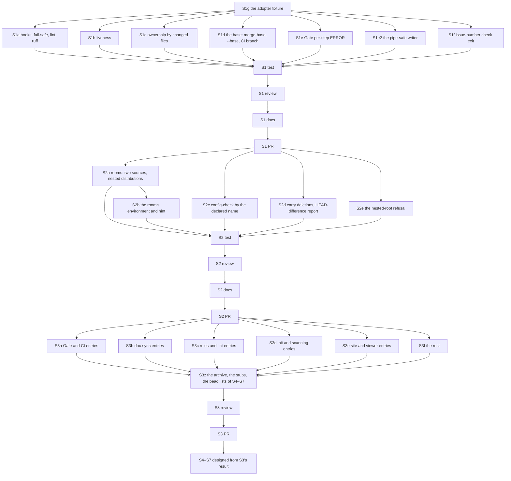

# PLAN: BDL-083 — Debt to zero

> **Status:** Approved
> **Created:** 2026-10-18

---

## Epic Description

Seven slices, one PR each, in the order of the PRD's ruling 1. This PLAN designs S1 and S2 to
the bead and S3 to the measurement bead; S4–S7 are designed when S3 closes, each as a section
appended here and approved on its own (ruling 6). Beads are created per slice, after the section
is approved; existing beads that already hold an entry are reused, not duplicated.

## Dependency DAG

Parent: `beadloom-ba9w`.

## Beads

| ID | Tracker | Name | Priority | Depends On |
|---|---|---|---|---|
| S1g | `beadloom-483w` | dev: the adopter's layout as an anonymised fixture under `tests/fixtures/` — `backend/pyproject.toml` + `uv.lock`, `frontend/` (FSD, two spec files beside code), `.gitlab-ci.yml`, a domain and a feature sharing a subpackage name, `.beadloom/` initialised; a test that the fixture indexes | P0 | - |
| S1a | `beadloom-7i09` | dev: the composed hooks — pre-push exits non-zero with a sentence without `beadloom` on PATH and prints the verdict line or "the Gate did not run"; pre-commit runs `lint --strict` over the nodes of staged paths; the ruff leg shows stderr, tells exit 127 from 1, reads the owning project's configuration (D1; #326, #327) | P0 | S1g |
| S1b | `beadloom-q8x6` | dev: liveness for `forbid_import` and `test_import_boundary` — unmatchable glob vs live with nothing to ban, by the matcher on the glob's literal prefix; the second at `info` (D2; #328) | P0 | S1g |
| S1c | `beadloom-b23f` | dev: `derive_gate_ownership` attributes by the files a bead's commits changed; `unattributed` otherwise; the surfaces print the rule (D3; #329) | P0 | S1g |
| S1d | `beadloom-fgu8` | dev: `scope_base` — merge-base with the parent branch, `--base`, trunk as fallback; the base and the parent-attributed count in the headers of `scope-check`, the Gate step and `review-brief`; the CI branch from `GITHUB_HEAD_REF` or `CI_MERGE_REQUEST_SOURCE_BRANCH_NAME` (D4; #330, #344; `beadloom-tsqz` #300 closes inside) | P0 | S1g |
| S1e | `beadloom-ba9w.13` | dev: the Gate's per-step exception boundary and `ERROR` status; "N step(s) crashed" in the summary (D1; #318) | P0 | S1g |
| S1e2 | `beadloom-jwfc` | dev: `ci` writes through a writer that survives `EAGAIN` on a non-blocking pipe; the hook tells a Gate that crashed from one that failed; a test that hands it a non-blocking pipe (D1; #226) | P0 | S1g |
| S1f | `beadloom-6xdt` | dev: `issue-number check` and the Gate step share one function and one exit code (D5; #331) | P0 | S1g |
| S1T | `beadloom-rupp` | test: each S1 entry's own `Command` re-run on the fixture or this repository, red first then green; the three MAJOR moves as tests; the full tree once | P0 | S1a–S1f |
| S1R | `beadloom-pohj` | review: S1, bead id only; re-run after the fix beads | P0 | S1T, S1F1–S1F4 |
| S1F1 | `beadloom-4m0w` | dev: S1R Major 1 + Minor 5 — the post-step reports of the Gate inside the exception boundary; the lint summary counts statements at info | P0 | S1R (first pass) |
| S1F2 | `beadloom-ilrn` | dev: S1R Major 2 — the debt report counts `info` as neither an error nor a warning | P0 | S1R (first pass) |
| S1F3 | `beadloom-7kas` | dev: S1R Minors 3, 4, 6 and the nitpick — the printed ownership rule states its binding; the "can match none" sentence hedged; the hook names public; the fixture rule named for its glob | P0 | S1R (first pass) |
| S1F4 | `beadloom-ba9w.17` | dev: S1R — the MCP `complete_bead` gaps of the #318 class: `not_run` when the coverage report raised, the verdict room's census bounded | P0 | S1F3 |
| S1W | `beadloom-hfxv` | tech-writer: the ci-gate and rule-engine SPECs, `docs/guides/ci-setup.md` (the hook's new behaviour), `docs/guides/public-api.md` (the MAJOR moves), CHANGELOG | P0 | S1R |
| S1P | `beadloom-c5m5` | coordinator: S1 PR, merge on green | P0 | S1W |
| S2a | - | dev: `rooms` reads `.github/workflows/*.yml` and `.gitlab-ci.yml` as sources of legs, each room carrying its source; distributions by `**/pyproject.toml` under `scan_paths`; a CI the census cannot read is a named skip in `ci`; `gate-coverage` reads the same sources (D6; #332) | P0 | S1P |
| S2b | - | dev: `clean-room` builds the environment of the distribution that owns the carried files from its `uv.lock` (`uv sync --frozen`), derives the "Measure in the room" hint from it, names the no-`.git` limit (D6; #333; `beadloom-ba9w.1` #311 closes inside) | P0 | S2a |
| S2c | - | dev: `config-check` composes by the declared project name and names both files; one verdict in a room, a worktree and the checkout (D7; #334) | P0 | S1P |
| S2d | - | dev: `--carry` of a path the tree no longer holds is a deletion in the room; the room reports files where the tree differs from HEAD by more than this bead's commits (D6; #335) | P0 | S1P |
| S2e | `beadloom-7pd6` | dev: a project root below the git root is refused by `init` and `doctor` in words, non-zero (D6; #325) | P0 | S1P |
| S2T | - | test: each S2 entry's own `Command` on the fixture — a named room, a built environment, one `config-check` verdict in a room and the checkout; the full tree once | P0 | S2a–S2e |
| S2R | - | review: S2, bead id only | P0 | S2T |
| S2W | - | tech-writer: the verdict-room and wave-plan SPECs, `docs/guides/parallel-waves.md` (the room's environment and hint), the monorepo paragraph of `docs/getting-started.md`, CHANGELOG | P0 | S2R |
| S2P | - | coordinator: S2 PR, merge on green | P0 | S2W |
| S3a | - | measure: the open entries of the Gate, CI, hooks and rooms area, each re-run by its `Command` on the S2 version; closed with evidence, filed as a bead under `beadloom-ba9w`, or put to the owner for a `Won't fix` ruling (D9) | P0 | S2P |
| S3b | - | measure: the doc-sync and docs-audit entries, the same protocol | P0 | S2P |
| S3c | - | measure: the rules, lint and liveness entries | P0 | S2P |
| S3d | - | measure: the `init`, scanning and `doctor` entries | P0 | S2P |
| S3e | - | measure: the site, viewer and portal entries | P0 | S2P |
| S3f | - | measure: every remaining entry (TUI, MCP, federation, release, process) | P0 | S2P |
| S3z | - | dev: the archive and the stubs written, #196 and #288 accounted for, `measured_on` stamped on every surviving entry, the bead lists of S4–S7 drafted as PLAN sections for the owner | P0 | S3a–S3f |
| S3R | - | review: S3 — every close carries evidence, every live entry a bead, every ruling a reason; bead id only | P0 | S3z |
| S3P | - | coordinator: S3 PR, merge on green; the S4–S7 sections put to the owner | P0 | S3R |

S4–S7 are not in this table yet: their beads are drawn from S3z's result and appended here as
sections, each approved before its beads are created.

## Bead Details

Each dev bead's "what to do" is its RFC decision; "done when" is the PRD goal's *Done when*
plus: the entry's own `Command` red first on the fixture or this repository and green after;
the MAJOR moves as tests; two-level verification; the full tree once per slice by its test bead;
commits by path under the landing lock; the entry's text in the issue log untouched until S3
closes it with the evidence the test bead recorded. `beadloom waves` derives the waves from the
beads' scopes: S1d, S1e, S1e2 and S1f share `application/gate.py` and `services/commands/federation.py`,
so the derivation, not this table, says which of them run together. Measurement beads of S3
write no code; their output is the archive text, the bead list and the rulings list, each line
with the date, the version and the command that was run.
